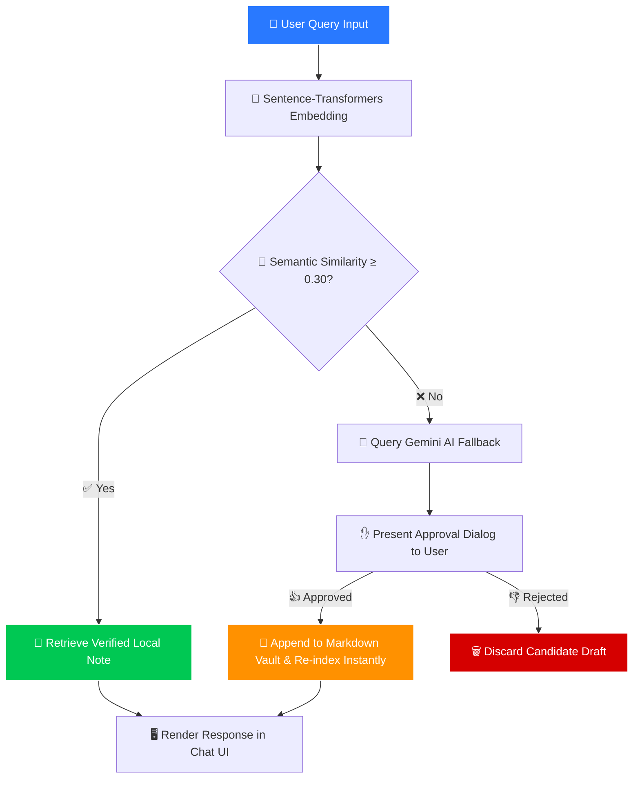

<div align="center">

<a name="top"></a>


<br/>
<p align="center">
<a href="#-overview"></a>&nbsp;
<a href="#-demo"></a>&nbsp;
<a href="#%EF%B8%8F-architecture"></a>&nbsp;
<a href="#-risk-grading"></a>&nbsp;
<a href="#-colab-quickstart"></a>&nbsp;
<a href="#-roadmap"></a>
</p>

<p align="center">


</p>

<p align="center">


</p>


<div align="center">

### 🟢 `✅ Answers from your verified notes first`
### 🟣 `🤖 Intelligent Gemini AI fallback second`
### 🟠 `✋ Complete human approval control — always`

</div>
</div>

<br/>

## 📌 Table of Contents

- [🌟 Overview](#-overview)
- [🧠 System Architecture & Workflow](#️-system-architecture--workflow)
- [🛡️ Risk Grading Engine](#-risk-grading-engine)
- [💡 Key Advantages](#-key-advantages)
- [⚡ Problem Solving Matrix](#-problem-solving--risk-mitigation)
- [💻 Running in Google Colab](#-running-in-google-colab)
- [🧰 Tech Stack](#-tech-stack)
- [🗺️ Roadmap](#-roadmap)
- [📜 License](#-license)


## 🌟 Overview

<div align="center">

</div>

**AgenticRAGreement** is a next-generation, agentic **Retrieval-Augmented Generation (RAG)** assistant designed for rigorous **contract, agreement, and policy document** analysis. 🧾

Unlike traditional black-box chatbots 🚫, AgenticRAGreement guarantees **full transparency and security** by checking your local verified knowledge base first using **semantic vector search**. If a query falls outside your verified documents, **Gemini AI** proposes a candidate answer — which is **only** written to your markdown vault and indexed upon your **explicit approval**. ✋

> 🎯 **The golden rule:** *Nothing enters your vault without you saying so.*


## 🧠 System Architecture & Workflow



<details>
<summary><b>🔍 Click to expand: How the agentic pipeline works</b></summary>

1. **📝 Ingest** — Documents are chunked and embedded with `all-MiniLM-L6-v2`.
2. **🎯 Retrieve** — Cosine similarity search returns the best local match.
3. **🤖 Fallback** — Low similarity triggers a Gemini 2.5 Flash draft.
4. **✋ Approve** — You review the draft in a dialog. Approve or reject.
5. **💾 Commit** — Approved drafts are appended to the vault and re-indexed live.
6. **📊 Grade** — Every response carries a live risk badge 🔴🟡🟢.

</details>


## 🛡️ Risk Grading Engine

AgenticRAGreement goes beyond simple text retrieval by **automatically auditing** agreements and policies for predatory clauses and hidden risks. Every response is dynamically graded to protect your interests:

<div align="center">

| Grade | Meaning | Detected Issues |
| :---: | :--- | :--- |
| 🔴 **Critical Danger** | Severe legal traps detected | Total liability waivers, forced arbitration, data selling loops, silent background data harvesting |
| 🟡 **Caution** | Ambiguous or restrictive terms | Catch-all phrases, auto-renewal traps, unilateral modification rights |
| 🟢 **Safe / Low Risk** | Standard & fair provisions | Operational clauses, transparent user guidelines |

</div>


## 💡 Key Advantages

<div align="center">

</div>

- 🕳️ **Zero-Blind-Spots Audit:** Unlike generic LLMs that hallucinate legal text, AgenticRAGreement cross-references every phrase against your curated compliance vault.
- 👑 **Complete User Sovereignty:** No automated background writes or unverified data ingestion. You hold the master switch over what gets committed.
- ⚡ **Blazing Fast Local Retrieval:** Semantic vector search processes queries instantly using lightweight local embeddings (`all-MiniLM-L6-v2`).
- 🔒 **Privacy-First Design:** Sensitive corporate agreements and terms remain local and secure under your direct management.


## ⚡ Problem Solving & Risk Mitigation

| 😤 Challenge in Traditional T&Cs | 🦾 How AgenticRAGreement Solves It |
| :--- | :--- |
| **🕳️ Buried Legal Traps** | Instantly scans fine print to surface hidden liability waivers and class-action bans. |
| **🔄 Unilateral Changes** | Tracks modifications and flags clauses allowing companies to alter terms retroactively. |
| **👁️ Aggressive Data Tracking** | Exposes background device harvesting, device fingerprinting, and third-party data sales. |


## 💻 Running in Google Colab

You can test and run **AgenticRAGreement** instantly inside a Google Colab notebook with **zero local environment setup**. ☁️

1. 🌐 **Open Google Colab**: Head over to [Google Colab](https://colab.research.google.com/) and start a **New Notebook**.
2. 🔑 **Configure Your API Key**:

- Click on the **🔑 Key icon (Secrets)** on the left sidebar of Colab.
- Add a new secret with the name `GEMINI_API_KEY` and paste your Google Gemini API key.

3. 📦 **Install Core Dependencies**: Paste and run this command in your first code cell:

```python
   %pip install -q sentence-transformers google-generativeai gradio
```

4. 🧠 **Initialize Knowledge Base & Agent Core**: Set up your local markdown vault folders (`knowledge/fraud/`, `knowledge/agreements/`), load your embedding model (`all-MiniLM-L6-v2`), and configure the Gemini API client using Colab secrets:

```python
   import google.generativeai as genai
   from google.colab import userdata

   genai.configure(api_key=userdata.get("GEMINI_API_KEY"))
   gemini = genai.GenerativeModel("gemini-2.5-flash")
```

5. 🚀 **Launch the Gradio App**: Execute your Gradio blocks cell to spin up the interactive user interface:

```python
   demo.launch(share=True, debug=False)
```

6. 🎮 **Interact & Audit**: Click the public `gradio.live` URL generated in the output console to test terms and conditions safety risks, view real-time risk grading, and approve new knowledge entries right from your browser! 🚀


## 🧰 Tech Stack

<div align="center">

| Layer | Technology | Badge |
| :--- | :--- | :--- |
| 🧠 AI Model | Google Gemini 2.5 Flash |  |
| 🔢 Embeddings | `all-MiniLM-L6-v2` |  |
| 🖥️ UI | Gradio 5.0+ |  |
| 💾 Storage | Local Markdown Vault |  |
| 🔎 Retrieval | Cosine Similarity ≥ 0.30 |  |

</div>


## 🗺️ Roadmap

We are continuously evolving AgenticRAGreement to make legal document and terms analysis smarter and more robust:

- [ ] 🌐 **Live URL Scraper:** Direct input of public Terms of Service or Privacy Policy web links for instant automated parsing.
- [ ] 📊 **Batch Document Analytics:** Multi-file drag-and-drop comparison matrix to contrast terms across competing services.
- [ ] ⚙️ **Customizable Risk Profiles:** Tailor danger thresholds and warning weights based on industry-specific compliance requirements (GDPR, HIPAA, CCPA).
- [ ] 🔌 **API & CI/CD Integrations:** Automated policy compliance checks for software dependencies and vendor agreements.


## 📜 License

Distributed under the **MIT License**. See `LICENSE` for more information. 💚

<div align="center">


</div>
